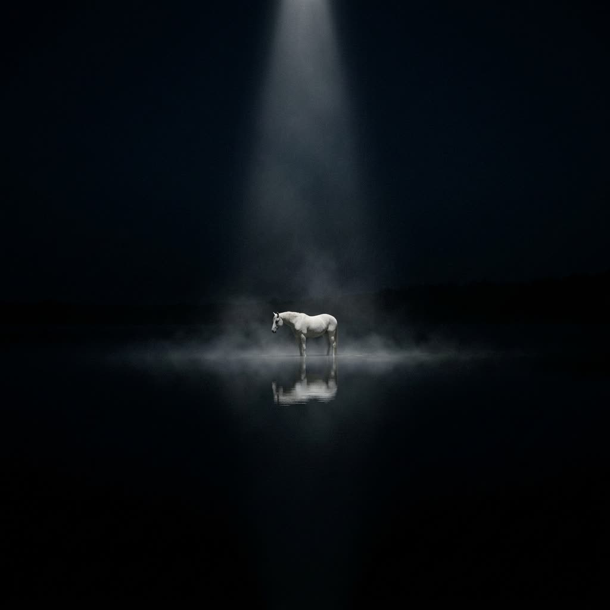
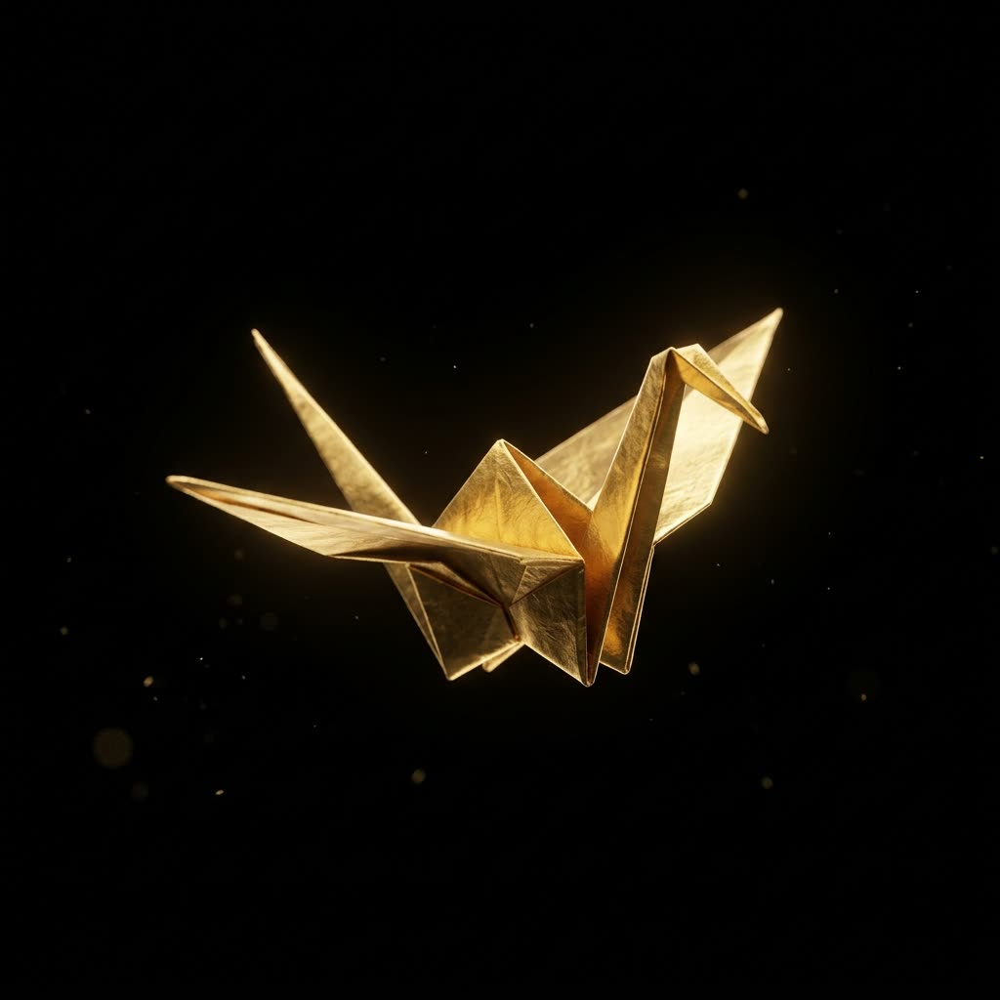
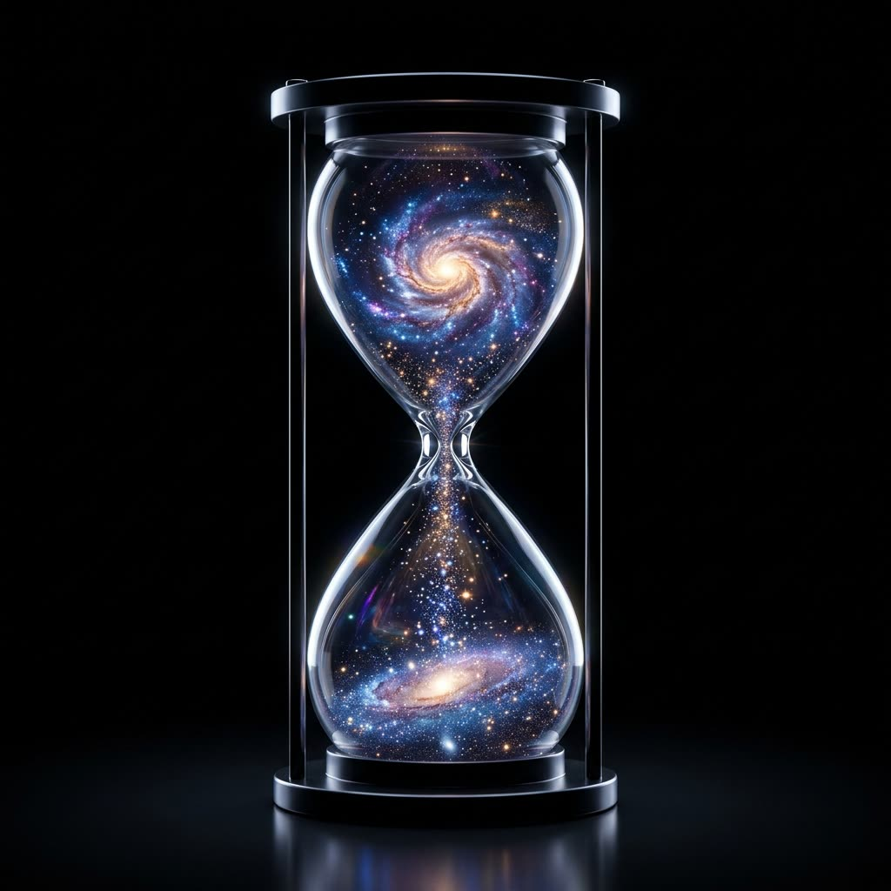
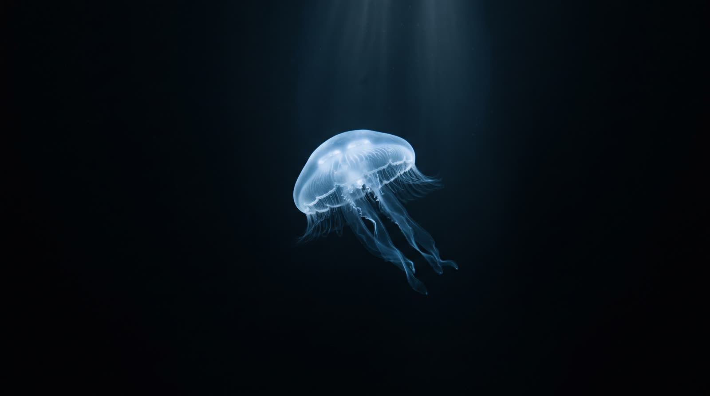

# Nano Banana 2.1 API

Call Google's **Nano Banana 2.1** (`gemini-nano-banana-2.1`, GA 2026-10-06) from code, compare what every channel charges for it, and copy prompts that work.

One API key reaches several channels that serve the model. [Yir](https://yir.ai/?utm_source=github&utm_medium=repo&utm_campaign=nano-banana-2.1-api&utm_content=intro) routes each request to the channel that is up and cheapest, falls back when one fails, and bills you exactly what that channel billed. No markup, no subscription.

## Prices by channel

<!-- yir:prices:start -->
| Output | Official | APIMart | KIE |
|---|---:|---:|---:|
| 1K · 1:1 | $0.0336 | $0.02 | **$0.015** |
| 2K · 1:1 | $0.0504 | **$0.025** | **$0.025** |
| 4K · 1:1 | $0.1134 | **$0.03** | $0.04 |

Per image, USD. Official is the model maker's list price; the other columns are channel prices as published by Yir on 2026-10-09, and **bold** is the cheapest channel available that day. Yir charges what the channel actually bills, with no markup, and nothing when the channel bills nothing. [Live prices](https://yir.ai/models/nano-banana-2-1?utm_source=github&utm_medium=repo&utm_campaign=nano-banana-2.1-api&utm_content=prices).
<!-- yir:prices:end -->

Text-to-image and image editing cost the same. Up to 14 reference images per edit.

## Quick start

```bash
npm install @yir-ai/sdk
export YIR_API_KEY=...   # new accounts get free trial credit: https://yir.ai/console?utm_source=github&utm_medium=repo&utm_campaign=nano-banana-2.1-api&utm_content=signup
node examples/generate.mjs "A lone white horse in still black water under moonlight" 2K 16:9
```

```js
import { createNodeYirClient } from "@yir-ai/sdk/server";

const client = createNodeYirClient();
const job = await client.submitImage({
  model: "google/nano-banana-2.1",
  input: { type: "text", prompt: "An origami crane folded from glowing gold foil, suspended in darkness" },
  parameters: { resolution: "2K", aspect_ratio: "16:9" },
  max_cost: "0.20",
});
const done = await client.waitForJob(job.id);
console.log(done.result.files[0].url, done.billing.total_charged_by_yir);
```

Prefer raw HTTP? `POST https://gateway.yir.ai/v1/images/generations` with `Authorization: Bearer $YIR_API_KEY`. See the [API reference](https://docs.yir.ai/?utm_source=github&utm_medium=repo&utm_campaign=nano-banana-2.1-api&utm_content=docs).

## Parameters

<!-- yir:params:start -->
| Parameter | Values | Default | Notes |
|---|---|---|---|
| `resolution` | `1K`, `2K`, `4K` | `1K` | Output resolution. |
| `aspect_ratio` | `auto`, `21:9`, `16:9`, `3:2`, `4:3`, `5:4`, `1:1`, `4:5`, `3:4`, `2:3`, `9:16`, `4:1`, `1:4`, `8:1`, `1:8` | `auto` | Output aspect ratio. |
| `n` | `1` | `1` | Number of generated outputs. |
<!-- yir:params:end -->

## Prompts

Generated with this model through the example above. Prompts are free to reuse.

| | |
|---|---|
|  | **Moonlit horse** · 1K · 1:1<br>`A lone white horse standing in perfectly still shallow black water at night under a single narrow beam of moonlight, mirror reflection, faint mist, vast dark negative space, fine-art photograph, cinematic, quiet. No text.` |
|  | **Gold crane** · 1K · 1:1<br>`An origami crane folded from a single sheet of glowing gold foil, suspended in pure darkness, crisp folds catching a soft rim light, a few floating golden dust motes, vast black negative space, minimal, premium, cinematic. No text.` |
|  | **Galaxy hourglass** · 1K · 1:1<br>`Studio product photograph on pure black: a crystal-clear glass hourglass, and instead of sand a tiny glowing spiral galaxy pours through the narrow neck, stars collecting in the lower bulb, precise rim light on the glass, vast black negative space, premium, cinematic. No text.` |
|  | **Deep-sea jellyfish** · 2K · 16:9<br>`Minimal underwater photograph in near-total darkness: one single translucent moon jellyfish glowing softly with a faint cool blue-white bioluminescence in pitch-black deep water, tendrils trailing, a single faint shaft of light from above, vast pure black negative space, no particles, no other creatures, pristine, cinematic, high dynamic range. No text.` |

Got a better one? Open a PR with the prompt, settings and image.

## Why route instead of calling one channel

- **Fallback.** If a channel is down or rejects the job, the same request moves to the next one. You are only billed for attempts a channel actually charged.
- **Verified delivery.** Yir checks each result's C2PA signature and output size, so a "4K" image from a channel that upscales 1K gets flagged, not passed off. [How channels are graded](https://yir.ai/blog/c2pa-ai-image-api-channel-check?utm_source=github&utm_medium=repo&utm_campaign=nano-banana-2.1-api&utm_content=grades).
- **Content safety.** Every request goes through content moderation; there is no "uncensored" mode.

## Updates

The price table and parameters are regenerated from Yir's public model API (`scripts/update-readme.mjs`, daily). Prices are channel list prices at that time, not a quote; call `quoteImage` before submitting.

## License

MIT. Example images were generated by Yir and may be reused freely.
