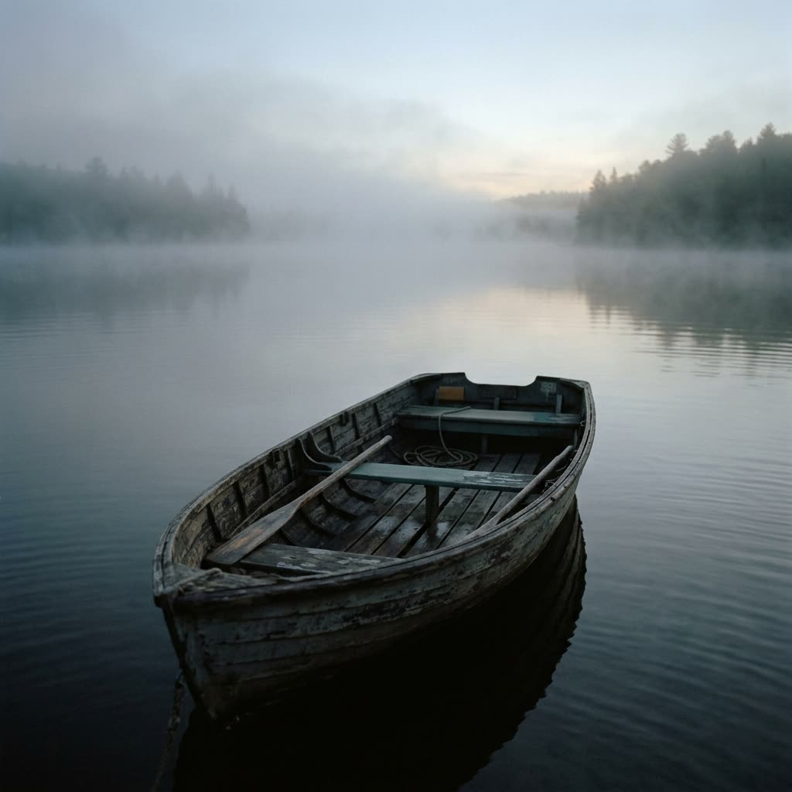

# Nano Banana 2.1 API

Call Google's **Nano Banana 2.1** (`gemini-nano-banana-2.1`) from code, compare what every channel charges for it, and copy prompts that work. It renders 1K to 4K stills, edits with up to 14 reference images, and accepts frames as wide as 8:1.

One API key reaches every channel that serves Nano Banana 2.1. [Yir](https://yir.ai/?utm_source=github&utm_medium=repo&utm_campaign=nano-banana-2.1-api&utm_content=intro) routes each request to the channel that is up and cheapest, falls back when one fails, and bills that channel's published price. No markup, no subscription.

<!-- yir:facts:start -->
| | |
|---|---|
| Model ID | `google/nano-banana-2.1` (aliases `nano-banana-2.1`, `gemini-nano-banana-2.1`, `google/gemini-nano-banana-2.1`) |
| Maker | Google, released 2026-10-06 ([source](https://ai.google.dev/gemini-api/docs/models/gemini-nano-banana-2.1)) |
| Inputs | Text-to-image, image editing |
| Output | 1K, 2K, 4K · 14 aspect ratios (8:1 to 1:8) |
| Channels on Yir | APIMart, FAL, Google, KIE |
<!-- yir:facts:end -->

## Examples

Generated with this model through Yir. Prompts are free to reuse, and the cost is what that job was billed.

| | |
|---|---|
|  | **Moonlit horse** · Text-to-image · 1K · 1:1 · $0.015 via KIE<br>`A lone white horse standing in perfectly still shallow black water at night under a single narrow beam of moonlight, mirror reflection, faint mist, vast dark negative space, fine-art photograph, cinematic, quiet. No text.` |
|  | **Gold crane** · Text-to-image · 1K · 1:1 · $0.015 via KIE<br>`An origami crane folded from a single sheet of glowing gold foil, suspended in pure darkness, crisp folds catching a soft rim light, a few floating golden dust motes, vast black negative space, minimal, premium, cinematic. No text.` |
|  | **Galaxy hourglass** · Text-to-image · 1K · 1:1 · $0.015 via KIE<br>`Studio product photograph on pure black: a crystal-clear glass hourglass, and instead of sand a tiny glowing spiral galaxy pours through the narrow neck, stars collecting in the lower bulb, precise rim light on the glass, vast black negative space, premium, cinematic. No text.` |
|  | **Deep-sea jellyfish** · Text-to-image · 2K · 16:9 · $0.025 via KIE<br>`Minimal underwater photograph in near-total darkness: one single translucent moon jellyfish glowing softly with a faint cool blue-white bioluminescence in pitch-black deep water, tendrils trailing, a single faint shaft of light from above, vast pure black negative space, no particles, no other creatures, pristine, cinematic, high dynamic range. No text.` |
|  | **Fog rowboat** · Text-to-image · 1K · 1:1 · $0.015 via KIE<br>`An empty wooden rowboat drifting on a fog-covered lake at dawn, 35mm film still, muted colors, quiet. No text.` |
|  | **Lantern at dusk** · Image editing · 1K · 1:1 · $0.015 via KIE<br>An edit: the fog rowboat above as the only reference image.<br>`Same rowboat on the same lake, now at dusk: a single paper lantern glows on the bow, its warm light reflected in the still water, the fog thinning. Keep the composition and the film look. No text.` |

Got a better one? Open a PR with the prompt, settings and output.

## Prices by channel

<!-- yir:prices:start -->
| Output | Official | APIMart | KIE |
|---|---:|---:|---:|
| 1K | $0.0336 | $0.02 | **$0.015** |
| 2K | $0.0504 | **$0.025** | **$0.025** |
| 4K | $0.1134 | **$0.03** | $0.04 |

Per image (1:1), USD. Official is the model maker's list price; the other columns are channel prices as published by Yir on 2026-10-18, and **bold** is the cheapest channel available that day. Yir bills the published price of the channel that ran the job, with no markup, and nothing when the channel bills nothing. [Live prices](https://yir.ai/models/nano-banana-2-1?utm_source=github&utm_medium=repo&utm_campaign=nano-banana-2.1-api&utm_content=prices#model-prices).

Text-to-image and image editing cost the same. FAL and Google also serve this model with per-job pricing, so they are not listed.
<!-- yir:prices:end -->

## Quick start

```bash
npm install
export YIR_API_KEY=...   # verified new accounts get a one-time trial credit: https://yir.ai/console?utm_source=github&utm_medium=repo&utm_campaign=nano-banana-2.1-api&utm_content=signup
node examples/generate.mjs "A lone white horse in still black water under moonlight, fine-art photograph, quiet. No text." resolution=2K aspect_ratio=16:9
```

```js
import { createNodeYirClient } from "@yir-ai/sdk/server";

const client = createNodeYirClient();
const job = await client.submitImage({
  model: "google/nano-banana-2.1",
  input: { type: "text", prompt: "A lone white horse in still black water under moonlight, fine-art photograph, quiet. No text." },
  parameters: { resolution: "2K", aspect_ratio: "16:9" },
});
const done = await client.waitForJob(job.id);
console.log(done.result.files[0].url, done.billing.total_charged_by_yir);
```

No Node? [`examples/generate.py`](examples/generate.py) uses only the Python standard library, and [`examples/curl.sh`](examples/curl.sh) does the same with curl and jq. Both call `POST https://gateway.yir.ai/v1/images/generations` with `Authorization: Bearer $YIR_API_KEY`; see the [API reference](https://docs.yir.ai/getting-started/quickstart?utm_source=github&utm_medium=repo&utm_campaign=nano-banana-2.1-api&utm_content=docs).

## Inputs

<!-- yir:inputs:start -->
| Mode | `input.type` | What you send |
|---|---|---|
| Text-to-image | `text` | A prompt. |
| Image editing | `image` | A prompt plus 1–14 reference images (`reference_image`). |
<!-- yir:inputs:end -->

Image editing:

```json
{
  "model": "google/nano-banana-2.1",
  "input": {
    "type": "image",
    "prompt": "Keep the subject, change the background to a foggy pier at dawn",
    "references": [
      {
        "role": "reference_image",
        "url": "https://example.com/image.jpg"
      }
    ]
  },
  "parameters": {
    "resolution": "2K",
    "aspect_ratio": "16:9"
  }
}
```

## Parameters

<!-- yir:params:start -->
| Parameter | Values | Default | Notes |
|---|---|---|---|
| `resolution` | `1K`, `2K`, `4K` | `1K` | Output resolution. |
| `aspect_ratio` | `auto`, `21:9`, `16:9`, `3:2`, `4:3`, `5:4`, `1:1`, `4:5`, `3:4`, `2:3`, `9:16`, `4:1`, `1:4`, `8:1`, `1:8` | `auto` | Output aspect ratio. |
| `n` | `1` | `1` | Number of outputs from one API request (one Job), not the application batch size. For multiple Jobs, submit separate requests; n=1 does not prevent application-managed batching. |
<!-- yir:params:end -->

## Good to know

- For edits, send each reference as a `reference_image` entry in `input.references`; describe in the prompt what to keep from each one.
- `aspect_ratio` defaults to `auto`; pass a ratio when the layout matters, such as `4:1` for a banner or `1:8` for a tall strip.
- Draft at 1K, then rerun only the keepers at 2K or 4K; the table shows the step-up at each channel.

## Why route instead of calling one channel

- **Fallback.** If a channel is down or rejects the job, the same request moves to the next one. You are only billed for attempts a channel actually charged.
- **Verified delivery.** Yir checks delivered files' C2PA signatures and output size; channels found upscaling are labelled "Upscaled" on the model page and left out of default routing. [How channels are graded](https://yir.ai/blog/c2pa-ai-image-api-channel-check?utm_source=github&utm_medium=repo&utm_campaign=nano-banana-2.1-api&utm_content=grades).
- **Content safety.** Every request goes through content moderation; there is no "uncensored" mode.

## Updates

The facts, price table, inputs and parameters above are regenerated daily from Yir's public model API. Prices are channel list prices at that time, not a quote; quote the request before submitting, as the examples do. [Model page](https://yir.ai/models/nano-banana-2-1?utm_source=github&utm_medium=repo&utm_campaign=nano-banana-2.1-api&utm_content=model).

## License

MIT. Example images were generated through Yir and may be reused freely.
